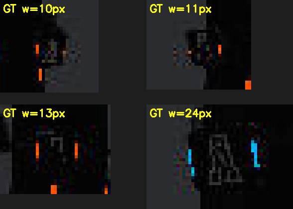
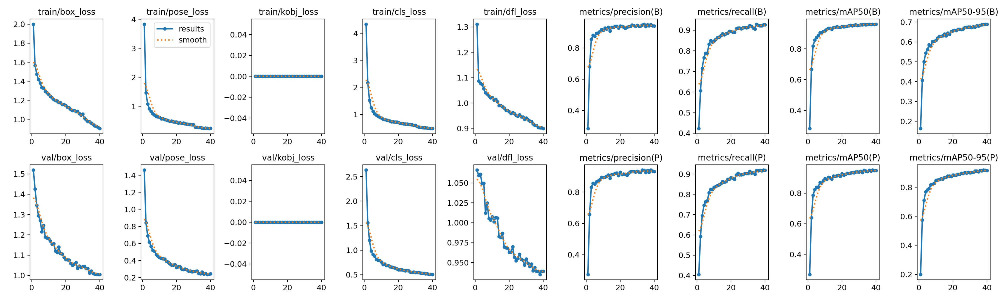
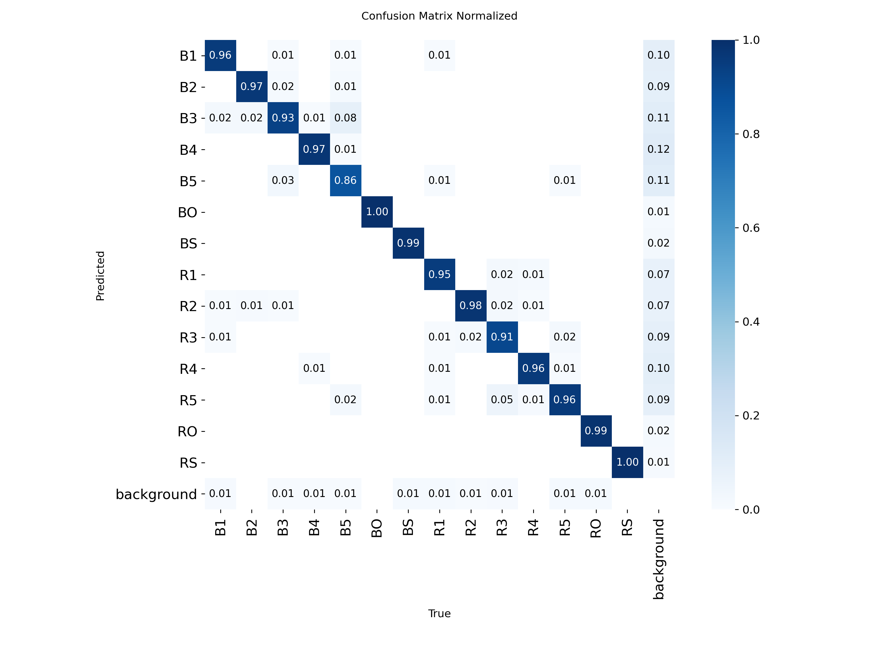
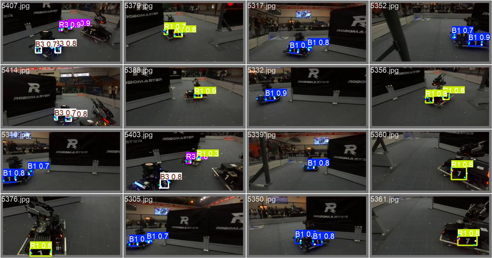

# 跃鹿战队算法组二阶段培训与考核

本仓库是面向学员的自瞄教学骨架。

## 目录结构

```text
hnurmvision-training/
├── CMakeLists.txt              # 培训主程序构建配置
├── README.md
├── configs/
│   └── simulation.yaml         # 显示、发射许可、相机内参和坐标变换
├── include/
│   ├── lessons.hpp             # 第二至第五讲函数声明
│   ├── tracking_state.hpp      # 第四讲跨帧状态
│   └── types.hpp               # 各讲之间传递的数据类型
├── io/
│   ├── config.cpp/.hpp         # YAML 读取和校验
│   └── io_context.hpp          # 第二讲 IO 状态与四个操作声明
├── lessons/
│   ├── lesson02_io.cpp         # 第二讲：仿真 IO
│   ├── lesson03_detection.cpp  # 第三讲：装甲板检测
│   ├── lesson04_tracking.cpp   # 第四讲：位姿与跟踪
│   └── lesson05_aiming.cpp     # 第五讲：弹道与瞄准
├── src/
│   └── main.cpp                # 单线程顺序主循环
├── scripts/                    # 构建和启动入口
├── docs/                       # 课程讲义和仿真环境简介
└── simulation/
    ├── simulator/              # Bevy 仿真器源码、资产和 config.toml
    ├── ros2/                   # 仿真通信使用的 hnurm_interfaces
    └── tools/                  # 场地生成辅助工具
```

## 编译

### 环境要求

- Ubuntu 22.04
- ROS2 Humble、colcon、ament_cmake
- CMake、支持 C++17 的编译器
- OpenCV、Eigen3、yaml-cpp
- Rustup 和 Rust 1.95.0（只在编译仿真器时需要）

所有命令都在仓库根目录执行。首次使用时先编译主程序及 ROS2 消息，再编译仿真器。

### 1. 编译培训主程序

```bash
./scripts/build_training.sh
```

该脚本依次完成：

1. 编译 `simulation/ros2/hnurm_interfaces`；
2. 配置根目录 CMake 工程；
3. 生成 `build/training`。

### 2. 编译仿真器

```bash
./scripts/build_simulator.sh
```

该脚本会生成教学场地、以 ROS2 特性编译 Bevy 仿真器，并生成：

```text
simulation/simulator/bin/daedalus
```

首次编译时间较长。修改仿真器 Rust 源码、资产生成逻辑或 ROS2 接口后需要重新执行；只修改
`lessons/`、`io/` 或 `src/` 时，重新执行 `build_training.sh`。

## 运行指南

运行时需要两个终端，并且两个终端都位于仓库根目录。

### 终端 1：启动仿真器

```bash
./scripts/run_simulator.sh
```

看到仿真窗口和训练场地后，再启动培训程序。脚本会自动配置 ROS2 环境、
`ROS_DOMAIN_ID=89`、动态库路径和仿真资产路径。

### 终端 2：启动培训程序

```bash
./scripts/run_training.sh
```

该脚本使用 `configs/simulation.yaml` 启动 `build/training`。初始骨架等待输入，按 Ctrl+C 退出；此时没有图像窗口和 ROS2 通信。


### 退出

- 完成第二讲并显示图像后，在培训图像窗口按 `q` 或 `Esc`；
- 或在对应终端按 `Ctrl+C`；
- 建议先退出培训程序，再关闭仿真器。

### 常用配置

运行配置位于 `configs/simulation.yaml`；学员还需要完成 `lessons/` 和 IO 骨架：

- `display`：是否显示培训图像窗口；
- `allow_fire`：是否允许最终发射，默认 `false`；
- 相机内参、畸变参数和相机到云台的坐标变换。

仿真场景和靶车由 `simulation/simulator/config.toml` 配置。`[training] enabled=true` 时生成
教学观察车和训练靶，设为 `false` 时回到手动场景。
This is the intro branch created by QingDu-z. 


                                                              
## 第二讲：IO 层（Open / Read / Write / Close）

实现：`io/io_context.hpp`（成员）、`lessons/lesson02_io.cpp`（四个方法）。

### 四阶段职责

| 阶段 | 做什么 |
|---|---|
| `open()` | 建节点、订阅 `/image_raw` 与 `/vision_receive_data`、发布 `/vision_send_data`、挂 executor |
| `read()` | `spin_once(2ms)` 抽回调；缓存图像与反馈；组装 `SensorData`；同一帧只交付一次 |
| `write()` | 门控（有限值/限位/有反馈/自瞄模式）→ 三态映射 → 弧度转度 → 发布 |
| `close()` | 先发一帧停止 → 摘节点 → 释放通信对象 → 按 `owns_context_` 决定是否 shutdown |

### 关键决策

| 决策 | 做法 | 原因 |
|---|---|---|
| ROS2 context 所有权 | `owns_context_` + `is_valid()` 判断 | `init/shutdown` 是进程级，不能替调用方关掉全局状态 |
| QoS | 订阅 `SensorDataQoS`（尽力）、发布 `QoS(10)`（可靠） | 发布端可靠可兼容任意订阅端；图像丢旧数据以控延迟 |
| 时间戳 | `ts = 收到时刻 - (ROS now - header.stamp)` | `header.stamp` 是拍摄时刻，需换算到 `steady_clock` |
| 姿态 | 欧拉角(度) → 四元数，**R = Rz(yaw)·Ry(pitch)·Rx(roll)** | 完整三维旋转，避免万向锁 |
| 图像 | `clone()` 后 `std::move` 移交 | 消息释放后指针悬空；移交不额外拷贝 |
| 单位与方向 | `Command`(rad) → 消息(deg)，原样回传 | 实测收发一致（发 -60/30°，反馈 -60/30°），无需加偏移 |
| `target_distance` | 控制时填 **0** | 文档 4.2：`-1` 表示输入非法、云台不再接受控制；实测填 `-1` 云台完全不动 |
| 安全门控 | 有限值、\|pitch\| ≤ 45°、有反馈、AUTO_AIM、`control`、`allow_fire` | 课件 3.4：IO 层是最后一道关口 |

### 时间对齐的近似与误差（课件 5.3 要求）

当前实现用“最近一次反馈”的姿态近似图像时刻的姿态：图像与反馈并非同一时刻到达，
云台转动时会产生与延迟成正比的姿态误差。

误差上界 ≈ **云台角速度 × 反馈与图像的时间差**。
代入仿真参数（云台 2.5 rad/s、单帧延迟 30 ms）：

```text
0.075 rad ≈ 4.3°；在 3 m 处对应横向偏差 ≈ 3 × tan(4.3°) ≈ 22 cm
```

小装甲板宽约 13 cm，因此高速转动时该近似必然导致脱靶。后续（第四讲起）
需按时间戳做姿态插值或预测补偿。

### 验收对照（课件 5.6 / 6.3）

| 项 | 结果 |
|---|---|
| 图像窗口显示相机画面 | ✅ |
| 终端每秒打印 `yaw/pitch/bullet_speed` | ✅ |
| 每 100 轮打印 IO 状态 | ✅ |
| 云台转动时数值跟随 | ✅ |
| `ros2 topic echo /vision_send_data --once` 有指令，`target_state=0` | ✅ |
| `allow_fire=false` 时不出现 FIRE | ✅ |
| 无数据不卡死、Ctrl+C 2 秒内退出 | ✅ |
| 退出后 `Publisher count: 0` | ✅ |

### 已知局限

- `feedback_.valid` 一旦为真不再失效：仿真器断开后仍会用旧姿态发指令（后续建议加 500 ms 过期判定）；     ------》》写第三讲时，我已修复此bug
- 角度方向仅在仿真器上验证，接真车需重新确认符号。
---

## 第三讲：装甲板检测（实现）

### 1. 任务 1 —— 传统视觉检测

实现文件：`lessons/lesson03_detection.cpp`（配合 `src/main.cpp` 的画框部分）。

管线：灰度阈值(150) → 竖向闭运算(3×5) → 灯条筛选（长宽比 1.6–12、长轴倾角 ≤20°）
→ 两两配对（高度差 ≤35%、中心差 ≤55%、间距比 0.8–5、板高 14–216 px）→ 输出四角点（左上/右上/右下/左下）。

指标（仿真器采集 53 帧，`tools/eval_detect`）：

| 口径 | GT | 检出 | 匹配 | recall | precision | 角点误差 |
|---|---|---|---|---|---|---|
| 全量 GT | 163 | 53 | 53 | 32.5% | 100% | 2.06 px |
| ≥30 px（3 m 正面目标） | 53 | 53 | 53 | **100%** | **100%** | 2.06 px |

全量口径含 110 块 <30 px 的侧板/停泊靶（最小 5 px，灯条仅 1–2 px），放宽阈值会引入场地线误检
（实测 precision 从 100% 降到 50%）。



### 2. 任务 2 —— YOLO-Pose 训练产物

- 权重：`runs/pose/armor_n-3/weights/best.pt`、`last.pt`（各 5.4 MB）
- 训练曲线：
- 类别混淆矩阵：
- 验证集预测对照：
- 推理可视化（带置信度）：`docs/pred/`
  - `2780.jpg` 近距大目标（板宽 ~927 px）
  - `6620.jpg` 常规距离（~115 px）
  - `1071.jpg` 小样本类 BO
  - `5687.jpg` 一图 14 个目标
  - `4097.jpg` 13 px 远距目标（**预期漏检**，用于说明能力下限）

训练配置：

| 项 | 值 |
|---|---|
| 模型 | YOLO11n-Pose（预训练微调） |
| 数据 | `dataset_norm`：train 5637 / val 1409，13 列 Pose 标签，`kpt_shape [4,2]` |
| 类别 | 14 类（B1–B5、BO、BS、R1–R5、RO、RS，0-based） |
| 参数 | epochs 40、imgsz 640、batch 8、device 0、`fliplr 0` |
| 指标 | box mAP50 **0.959** / mAP50-95 0.689；pose mAP50 **0.948** / mAP50-95 0.915 |

**局限说明**

1. 验证集 mAP50-95 高于同类公开项目（0.765），可能因 train/val 同源（相邻帧分到两侧）而偏乐观；
   真实泛化需按视频重新分组评估。
2. 标签做过角点顺序规范化（板体顺序 → 图像顺序 TL,TR,BR,BL，严格合规率 99.96%），
   训练时关闭水平翻转以避免顺序被破坏。
3. `class_id` 在传统管线中保留 `-1`（课件允许），语义由 Pose 模型提供。

### 3. 复现

```bash
./scripts/build_training.sh                                  # 编译
./build/eval_detect simulation/simulator/dataset             # 检测指标（双口径）
yolo pose train model=yolo11n-pose.pt data=configs/armor_pose.yaml \
  epochs=40 imgsz=640 batch=8 device=0 fliplr=0.0 name=armor_n
```

设计文档与答辩要点见 `docs/第三讲-检测学习路线.md`。

### 4. 演示录屏

> ⏳ 待补：任务 1 的运行录屏（四镜头：检测框、跨距离、多目标、漏检对照）。
